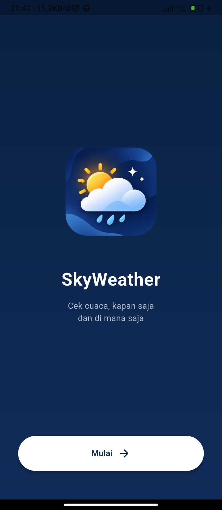
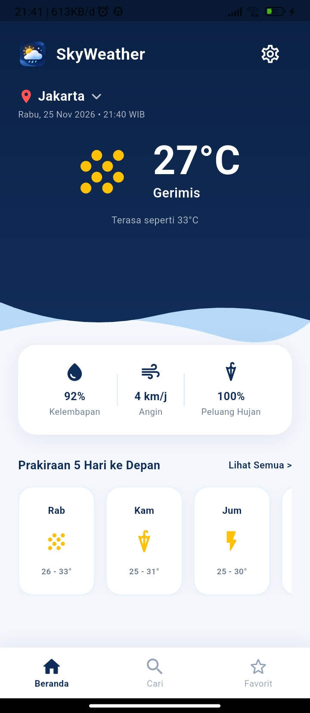
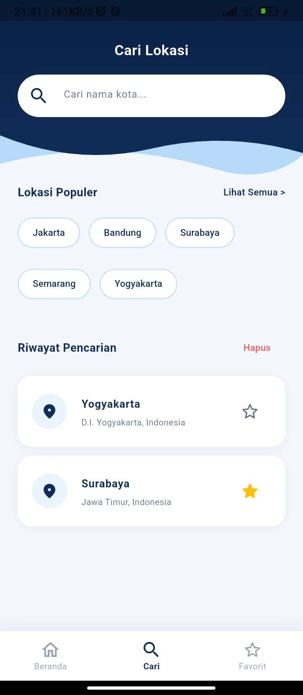
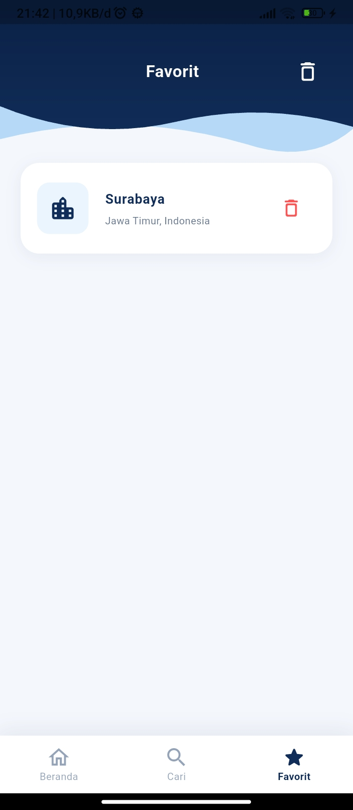

# 🌦️ Aplikasi Cuaca Flutter (SkyWeather)

Aplikasi cuaca berbasis Flutter (Dart) yang dikembangkan untuk memenuhi tugas **Responsi Praktikum Pemrograman Mobile**. Aplikasi ini mengimplementasikan pola arsitektur **MVVM (Model-View-ViewModel)** dengan state management **Provider** dan penyimpanan lokal **SharedPreferences**.

---

## 👤 Identitas Pemilik Proyek
- **Nama:** Bunga Budi Ambar Wati
- **NIM:** H1D024006
- **Shift:** F
- **Mata Kuliah Praktikum:** Pemrograman Mobile 

---

## 📖 DOKUMENTASI RINGKAS APLIKASI

### 1. 🏗️ Struktur Aplikasi & Pola Arsitektur MVVM

Aplikasi SkyWeather menerapkan arsitektur **MVVM (Model-View-ViewModel)** untuk menjaga pemisahan tanggung jawab (*separation of concerns*) antara antarmuka pengguna, logika bisnis, dan sumber data:

```text
lib/
├── models/         # [MODEL] Pemetaan data JSON dari API ke objek Dart
├── services/       # [SERVICE] Komunikasi jaringan REST API (HTTP GET)
├── repositories/   # [REPOSITORY] Pengelolaan penyimpanan data lokal (SharedPreferences)
├── viewmodels/     # [VIEWMODEL] Logika bisnis & pengelola State (ChangeNotifier)
├── views/          # [VIEW] Antarmuka antarmuka pengguna (UI Screens)
├── widgets/        # [WIDGETS] Komponen UI reusable (Cards, Headers, Tiles)
├── theme/          # [THEME] Konfigurasi warna & tipografi Material 3
└── main.dart       # Entry Point & Registrasi Provider
```

#### Alur Penerapan MVVM:
1. **Model (`lib/models/`)**: Memuat kelas data Dart (`Location`, `WeatherData`, `CurrentWeather`, `DailyForecast`). Masing-masing dilengkapi dengan `fromJson()` untuk konversi data dari server API.
2. **Service (`lib/services/`)**: `GeocodingService` dan `WeatherService` bertugas melakukan *networking* menggunakan metode HTTP GET.
3. **Repository (`lib/repositories/`)**: `LocationRepository` bertugas membaca dan menyimpan data lokal (`SharedPreferences`) seperti daftar favorit, riwayat pencarian, dan lokasi terakhir yang dipilih.
4. **ViewModel (`lib/viewmodels/`)**: `WeatherViewModel` dan `SearchViewModel` bertindak sebagai perantara yang memproses logika bisnis dan mengelola state aplikasi. Menggunakan `ChangeNotifier` dan memanggil `notifyListeners()` untuk memberi tahu UI saat terjadi perubahan state.
5. **View (`lib/views/`)**: Layar UI (`HomeScreen`, `SearchScreen`, `FavoriteScreen`, `DetailForecastScreen`, `OnboardingScreen`). **View tidak pernah memanggil API secara langsung**, melainkan mendengarkan state dari ViewModel menggunakan widget `Consumer`.

---

### 2. 🌐 Implementasi API (Open-Meteo REST API)

Aplikasi terhubung langsung secara real-time ke **Open-Meteo REST API** gratis tanpa kunci API (*API Key*):

#### A. Geocoding API (Pencarian Kota)
- **Endpoint**: `https://geocoding-api.open-meteo.com/v1/search`
- **Metode**: `HTTP GET`
- **Parameter**: 
  - `name`: Kata kunci nama kota yang dicari.
  - `count=10`: Membatasi maksimal 10 hasil.
  - `language=id`: Bahasa nama wilayah dalam Bahasa Indonesia.
  - `format=json`: Format respon server.
- **Fungsi**: Mengubah teks nama kota yang diinput pengguna menjadi daftar objek `Location` yang memuat koordinat lintang (*latitude*) dan bujur (*longitude*).

#### B. Weather Forecast API (Data Cuaca Terkini & Prakiraan)
- **Endpoint**: `https://api.open-meteo.com/v1/forecast`
- **Metode**: `HTTP GET`
- **Parameter**:
  - `latitude` & `longitude`: Koordinat lokasi kota terpilih.
  - `current`: Meminta data cuaca terkini (`temperature_2m`, `relative_humidity_2m`, `apparent_temperature`, `precipitation`, `weather_code`, `wind_speed_10m`).
  - `daily`: Meminta data prakiraan harian (`temperature_2m_max`, `temperature_2m_min`, `precipitation_probability_max`, `weather_code`).
  - `timezone=auto`: Penyesuaian zona waktu otomatis sesuai koordinat lokasi.
- **Fungsi**: Mengambil informasi cuaca lengkap terkini dan prakiraan harian 7 hari ke depan.

---

## 📸 Screenshot Aplikasi

Berikut adalah tampilan antarmuka aplikasi SkyWeather:

### 1. Onboarding Screen


### 2. Home Screen / Beranda Utama


### 3. Search Screen / Cari Lokasi & Lokasi Populer


### 4. State Pencarian Kosong (Hasil Tidak Ditemukan)


### 5. State Error / Offline Mode (Koneksi Terputus)


### 6. Pengaturan & Informasi Aplikasi


### 7. Favorite Screen / Kota Favorit Tersimpan

