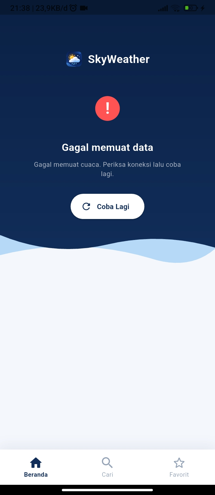
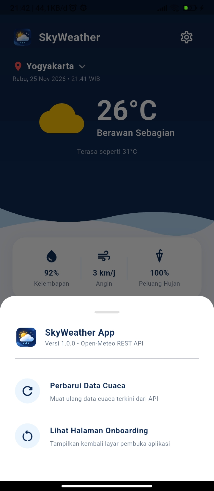

# Aplikasi Cuaca Flutter (SkyWeather)

Aplikasi cuaca berbasis Flutter (Dart) yang dikembangkan untuk keperluan responsi kuliah. Aplikasi ini menggunakan arsitektur MVVM (Model-View-ViewModel) dengan state management Provider dan penyimpanan lokal SharedPreferences.

---

## 👤 Identitas Pemilik Proyek
- **Nama:** Bunga Budi Ambar Wati
- **NIM:** H1D024006
- **Shift:** F
- **Mata Kuliah Praktikum:** Pemrograman Mobile 

---

## 🏗️ Struktur Folder dan Arsitektur MVVM

Aplikasi ini memisahkan logika bisnis, tampilan, dan sumber data ke dalam beberapa direktori:

- **lib/models/**: Berisi struktur data Dart (`Location`, `WeatherData`, `CurrentWeather`, `DailyForecast`) yang memetakan respons JSON dari API.
- **lib/services/**: Berisi layanan jaringan untuk melakukan HTTP GET request ke Open-Meteo API (`WeatherService` dan `GeocodingService`).
- **lib/repositories/**: Mengelola penyimpanan lokal menggunakan `SharedPreferences` (`LocationRepository`) untuk menyimpan lokasi favorit, riwayat pencarian, dan lokasi terakhir yang dipilih.
- **lib/viewmodels/**: Berisi logika aplikasi yang diturunkan dari `ChangeNotifier` (`WeatherViewModel` dan `SearchViewModel`). ViewModel bertindak sebagai perantara antara View dan Service/Repository.
- **lib/views/**: Berisi antarmuka pengguna (`HomeScreen`, `SearchScreen`, `FavoriteScreen`, `DetailForecastScreen`, `OnboardingScreen`). View hanya mendengarkan state dari ViewModel dan memicu fungsi di ViewModel tanpa memanggil service secara langsung.
- **lib/widgets/**: Komponen UI yang dapat digunakan kembali (*reusable widgets*) seperti kartu informasi cuaca, item perkiraan harian, dan item lokasi.
- **lib/theme/**: Pengaturan tema Material 3 (`AppTheme`).

---

## 🌐 Implementasi API (Open-Meteo)

Aplikasi menggunakan Open-Meteo REST API secara gratis tanpa kunci API (*API Key*):

1. **Geocoding API**:
   - Endpoint: `https://geocoding-api.open-meteo.com/v1/search`
   - Parameter: `name` (nama kota), `count=10`, `language=id`, `format=json`.
   - Digunakan pada `GeocodingService` untuk mencari koordinat lintang dan bujur berdasarkan nama kota.

2. **Weather Forecast API**:
   - Endpoint: `https://api.open-meteo.com/v1/forecast`
   - Parameter: `latitude`, `longitude`, `current=temperature_2m,relative_humidity_2m,apparent_temperature,precipitation,weather_code,wind_speed_10m`, `daily=temperature_2m_max,temperature_2m_min,precipitation_probability_max,weather_code`, `timezone=auto`.
   - Digunakan pada `WeatherService` untuk mengambil data cuaca terkini dan prakiraan harian.

---

## 📸 Screenshot Aplikasi

Berikut adalah tampilan antarmuka aplikasi SkyWeather:

### 1. Onboarding Screen

### 2. Home Screen / Beranda Utama

### 3. Search Screen / Cari Lokasi & Lokasi Populer

### 4. State Pencarian Kosong (Hasil Tidak Ditemukan)

### 5. State Error / Offline Mode (Koneksi Terputus)

### 6. Pengaturan & Informasi Aplikasi

### 7. Favorite Screen / Kota Favorit Tersimpan

